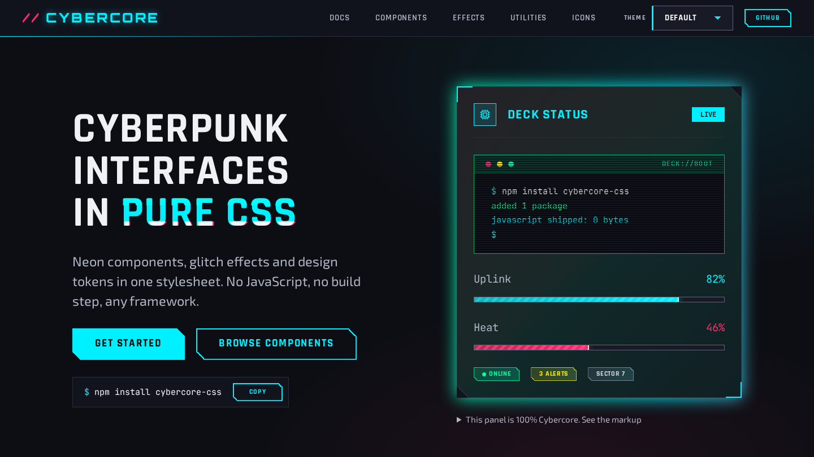
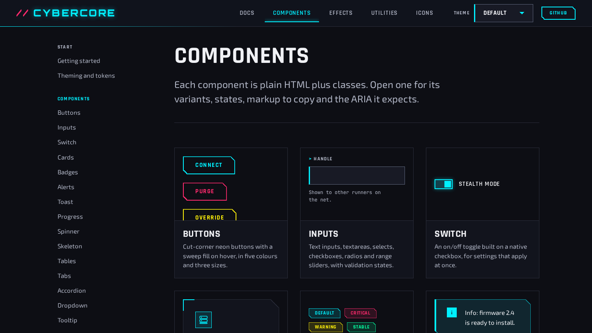

# CYBERCORE CSS

[](https://github.com/sebyx07/cybercore-css/actions/workflows/ci.yml)
[](https://www.npmjs.com/package/cybercore-css)
[](https://www.npmjs.com/package/cybercore-css)
[](https://www.jsdelivr.com/package/npm/cybercore-css)
[](https://cdn.jsdelivr.net/npm/cybercore-css/dist/cybercore.min.css)
[](LICENSE)
[](https://developerz.ai)

A pure CSS cyberpunk design framework: neon components, glitch effects, design tokens and 150+ SVG icons in one stylesheet. No JavaScript, no build step, any framework.

[](https://sebyx07.github.io/cybercore-css/)

**[Live demo and docs](https://sebyx07.github.io/cybercore-css/)** · [Components](https://sebyx07.github.io/cybercore-css/components/) · [Effects](https://sebyx07.github.io/cybercore-css/effects/) · [Utilities](https://sebyx07.github.io/cybercore-css/utilities/) · [Icons](https://sebyx07.github.io/cybercore-css/icons/) · [Theming](https://sebyx07.github.io/cybercore-css/docs/theming/)

- **Pure CSS.** The package ships a stylesheet, its Sass sources and icon definitions. Zero JavaScript, zero runtime dependencies.
- **Drop-in.** One `<link>` tag and `cyber-*` classes on plain HTML. Works with React, Vue, Svelte, Astro, Rails, Django or nothing at all.
- **Themeable.** Every colour, size, duration and glow is a CSS custom property. Override one token and the whole system follows.
- **Overridable.** Everything sits in cascade layers, so your own CSS wins without `!important`.
- **Accessible.** Visible focus rings, WCAG AA contrast, reduced motion, high contrast and forced colours are handled in the framework.
- **Stable names.** `cyber-*` classes and tokens are public API: they are not renamed or removed outside a major release.
- **AI-ready.** One-file class reference for coding agents: [`llms.txt`](llms.txt).

## Install

### CDN

Pin the version, so a new release never changes your page under you:

```html
<link
  rel="stylesheet"
  href="https://cdn.jsdelivr.net/npm/cybercore-css@0.4.0/dist/cybercore.min.css"
/>
```

The same file is on unpkg: `https://unpkg.com/cybercore-css@0.4.0/dist/cybercore.min.css`. The [getting started page](https://sebyx07.github.io/cybercore-css/docs/) prints this tag with a Subresource Integrity hash if you want one.

### npm

```bash
npm install cybercore-css
```

```js
// any entry file your bundler reads
import 'cybercore-css';
```

With Sass:

```scss
// Vite, webpack and other bundlers that read package exports
@use 'cybercore-css';

// or the core (layers, tokens, themes, reset) plus only the modules a page uses
@use 'cybercore-css/scss/core';
@use 'cybercore-css/scss/components/buttons';
@use 'cybercore-css/scss/effects/glitch';
```

```scss
// Plain Sass CLI: sass --pkg-importer=node
@use 'pkg:cybercore-css';
```

### Fonts (optional)

The framework bundles no fonts and falls back to system fonts. For the look in the screenshots, load Orbitron, Rajdhani, Exo 2 and JetBrains Mono:

```html
<link rel="preconnect" href="https://fonts.googleapis.com" />
<link rel="preconnect" href="https://fonts.gstatic.com" crossorigin />
<link
  href="https://fonts.googleapis.com/css2?family=Orbitron:wght@400;500;600;700;800;900&family=Exo+2:wght@300;400;500;600;700&family=JetBrains+Mono:wght@400;500;600&family=Rajdhani:wght@400;500;600;700&display=swap"
  rel="stylesheet"
/>
```

## Quick start

A complete page. Save it as `index.html` and open it:

```html
<!doctype html>
<html lang="en">
  <head>
    <meta charset="utf-8" />
    <meta name="viewport" content="width=device-width, initial-scale=1" />
    <title>Deck status</title>
    <link
      rel="stylesheet"
      href="https://cdn.jsdelivr.net/npm/cybercore-css@0.4.0/dist/cybercore.min.css"
    />
  </head>
  <body>
    <main class="cyber-p-lg">
      <h1 class="cyber-glitch" data-text="System online">System online</h1>

      <div class="cyber-card">
        <div class="cyber-card__header">
          <span class="cyber-card__title">Uplink</span>
        </div>
        <div
          class="cyber-progress cyber-mb-md"
          role="progressbar"
          aria-label="Uplink"
          aria-valuenow="82"
          aria-valuemin="0"
          aria-valuemax="100"
        >
          <div class="cyber-progress__bar" style="width: 82%"></div>
        </div>
        <div class="cyber-flex cyber-flex-wrap cyber-items-center cyber-gap-sm">
          <button class="cyber-btn" type="button">Run diagnostics</button>
          <button class="cyber-btn cyber-btn--magenta" type="button">Purge</button>
          <span class="cyber-badge cyber-badge--green">Online</span>
        </div>
      </div>
    </main>
  </body>
</html>
```

Every class is `cyber-<block>`, `cyber-<block>__<element>` or `cyber-<block>--<modifier>`. Colour modifiers are the same everywhere: `--magenta` (danger), `--yellow` (warning), `--green` (success); cyan is the default.

## Components

[](https://sebyx07.github.io/cybercore-css/components/)

Each one has a page in the [demo](https://sebyx07.github.io/cybercore-css/components/) with live variants, markup to copy, and the ARIA attributes and keys it expects.

| Group      | What is in it                                                                                                                                                                                                                                                                                                                                                                                                                                                                                                      |
| ---------- | ------------------------------------------------------------------------------------------------------------------------------------------------------------------------------------------------------------------------------------------------------------------------------------------------------------------------------------------------------------------------------------------------------------------------------------------------------------------------------------------------------------------ |
| Actions    | [Buttons](https://sebyx07.github.io/cybercore-css/components/buttons/), [Dropdown](https://sebyx07.github.io/cybercore-css/components/dropdown/)                                                                                                                                                                                                                                                                                                                                                                   |
| Forms      | [Inputs](https://sebyx07.github.io/cybercore-css/components/inputs/) (text, textarea, select, checkbox, radio, range, field, input group), [Switch](https://sebyx07.github.io/cybercore-css/components/switch/)                                                                                                                                                                                                                                                                                                    |
| Content    | [Cards](https://sebyx07.github.io/cybercore-css/components/cards/), [Tables](https://sebyx07.github.io/cybercore-css/components/tables/), [Terminal](https://sebyx07.github.io/cybercore-css/components/terminal/), [HUD](https://sebyx07.github.io/cybercore-css/components/hud/), [Accordion](https://sebyx07.github.io/cybercore-css/components/accordion/)                                                                                                                                                     |
| Feedback   | [Alerts](https://sebyx07.github.io/cybercore-css/components/alerts/), [Toast](https://sebyx07.github.io/cybercore-css/components/toast/), [Badges](https://sebyx07.github.io/cybercore-css/components/badges/), [Progress](https://sebyx07.github.io/cybercore-css/components/progress/), [Spinner](https://sebyx07.github.io/cybercore-css/components/spinner/), [Skeleton](https://sebyx07.github.io/cybercore-css/components/skeleton/), [Tooltip](https://sebyx07.github.io/cybercore-css/components/tooltip/) |
| Navigation | [Nav](https://sebyx07.github.io/cybercore-css/components/nav/), [Tabs](https://sebyx07.github.io/cybercore-css/components/tabs/), [Breadcrumb](https://sebyx07.github.io/cybercore-css/components/breadcrumb/), [Pagination](https://sebyx07.github.io/cybercore-css/components/pagination/)                                                                                                                                                                                                                       |
| Overlays   | [Modal](https://sebyx07.github.io/cybercore-css/components/modal/)                                                                                                                                                                                                                                                                                                                                                                                                                                                 |

**[Effects](https://sebyx07.github.io/cybercore-css/effects/):** `cyber-glitch` (text glitch), `cyber-neon-border` (animated glow frame), `cyber-scanlines`, `cyber-noise`, `cyber-datastream`. All are decorative, never block clicks, and stand still under reduced motion.

**[Utilities](https://sebyx07.github.io/cybercore-css/utilities/):** display, flex, grid, spacing, text, accessibility and animation helpers on the same tokens as the components, in the stylesheet. Ten more families (position, sizing, layout, backgrounds, borders, shadows, filters, transforms, transitions, interactivity) ship as Sass modules you load on demand. Reference: [docs/UTILITIES.md](docs/UTILITIES.md).

**[Icons](https://sebyx07.github.io/cybercore-css/icons/):** 150+ stroke icons in ten categories and four variants (outline, solid, duotone, glitch), as tree-shakeable SVG strings:

```js
import { renderIcon } from 'cybercore-css/icons';

const svg = renderIcon('terminal', { size: 24, 'aria-label': 'Open terminal' });
```

The framework ships no script. Most components need none; a few (tabs, modal, dropdown, toast, the mobile nav) need the page to toggle an attribute or a class, and their demo pages show the few lines.

## Theming

Tokens are CSS custom properties on `:root`. Override them in your own stylesheet, globally or on any subtree:

```css
:root {
  --cyber-cyan-500: #00ffaa; /* retints the whole cyan scale and everything accent-coloured */
  --glow-intensity: 0.5; /* dim every glow at once */
  --font-display: 'Orbitron', sans-serif;
}

.sidebar {
  --space-md: 1rem;
}
```

Switch the accent with an attribute, on the page or on one section:

```html
<html data-theme="magenta">
  <section data-theme="acid">…</section>
</html>
```

Built-in themes: `cyan` (default), `magenta`, `acid`, `amber`. `data-contrast="high"` and `data-motion="reduce"` force the high-contrast and reduced-motion behaviour that the framework otherwise takes from the user's system settings.

The framework's styles live in cascade layers (`reset, base, theme, components, utilities`), so any rule you write outside a layer wins, whatever its specificity:

```css
.cyber-btn {
  letter-spacing: 0.2em;
}
```

Cybercore is dark by design: there is no light palette. All tokens, live: [Theming and tokens](https://sebyx07.github.io/cybercore-css/docs/theming/).

## Accessibility

Cybercore CSS aims at WCAG 2.2 level AA for what a stylesheet controls:

- **Contrast.** Text meets 4.5:1 and large text, control boundaries and focus rings meet 3:1, in every colour variant.
- **Focus.** Every interactive component shows a visible `:focus-visible` ring that the cut corners and overlays never clip.
- **Reduced motion.** Under `prefers-reduced-motion: reduce` transitions become instant and glitch, flicker, scanline and loading animations stop. Nothing flashes more than three times a second.
- **High contrast and forced colours.** `prefers-contrast: more` raises text and border contrast and dims glows; Windows forced-colors mode keeps controls and states visible.
- **No colour-only meaning.** States are carried by text, shape or position as well as colour.
- **Semantics stay yours.** The framework styles native elements and ARIA attributes (`aria-selected`, `aria-expanded`, `aria-current`, `aria-disabled`) and each demo page documents the roles and keys a component expects. A stylesheet cannot add them for you.

Found a contrast, focus or motion problem? That is a bug: please [open an issue](https://github.com/sebyx07/cybercore-css/issues/new/choose).

## Browser support

| Browser         | Version |
| --------------- | ------- |
| Chrome and Edge | 111+    |
| Firefox         | 121+    |
| Safari          | 16.2+   |

The floor comes from cascade layers, `color-mix()` and `:has()`. Newer features (`@starting-style`, `:user-invalid`, `popover`) are used only as enhancements with a working fallback.

## AI agents

**This project is maintained by [developerz.ai](https://developerz.ai).** Its maintainer agent triages issues, reviews every pull request, merges every pull request once its author marks it ready and CI passes, and opens release pull requests. The policy is in [`.dz/maintainer/maintainer.yml`](.dz/maintainer/maintainer.yml). Breaking changes and major releases stay with the owner.

- **Using Cybercore CSS in your project?** Point your agent at [`llms.txt`](llms.txt), the class and token reference in one file. Paste this into your project's `CLAUDE.md` / `AGENTS.md`:
  ```markdown
  ## Cybercore CSS

  UI is styled with the cybercore-css framework (`cyber-*` classes, `--cyber-*` tokens). Before writing
  markup read https://github.com/sebyx07/cybercore-css/blob/main/llms.txt and use only classes listed there.
  ```
- **Working on this repo?** [`CLAUDE.md`](CLAUDE.md) holds the agent instructions (`AGENTS.md` points at the same file): commands, layout, invariants, how to verify a change. Design rules are in [`src/scss/CLAUDE.md`](src/scss/CLAUDE.md); Claude Code skills and reviewer agents live in `.claude/`.

## Contributing

Bug reports and pull requests are welcome, small ones included. [CONTRIBUTING.md](CONTRIBUTING.md) has the setup, the checks and how pull requests get merged; [CHANGELOG.md](CHANGELOG.md) has what changed; security reports go through [SECURITY.md](SECURITY.md).

```bash
bin/setup     # install
bin/dev       # demo site with hot reload
bin/check     # the same gate CI runs
```

### Contributors

Thank you to everyone who has sent a fix or a feature:

- [@mountainash](https://github.com/mountainash): optional utility styles in the demo ([#3](https://github.com/sebyx07/cybercore-css/pull/3))
- [@chadol27](https://github.com/chadol27): centred the icon spin animation ([#5](https://github.com/sebyx07/cybercore-css/pull/5))
- [@ctrisciuzzi](https://github.com/ctrisciuzzi): `cyber-input-group` and its addon ([#6](https://github.com/sebyx07/cybercore-css/pull/6)), `cyber-nav__link` fix ([#7](https://github.com/sebyx07/cybercore-css/pull/7))

[](https://github.com/sebyx07/cybercore-css/graphs/contributors)

## Related

- **[cybercore-charts](https://github.com/sebyx07/cybercore-charts)**: zero-dependency SVG charts in the same cyberpunk look, built to sit next to these components. [Demo](https://sebyx07.github.io/cybercore-charts).

## License

[MIT](LICENSE)

## Star history

[](https://star-history.com/#sebyx07/cybercore-css&Date)
